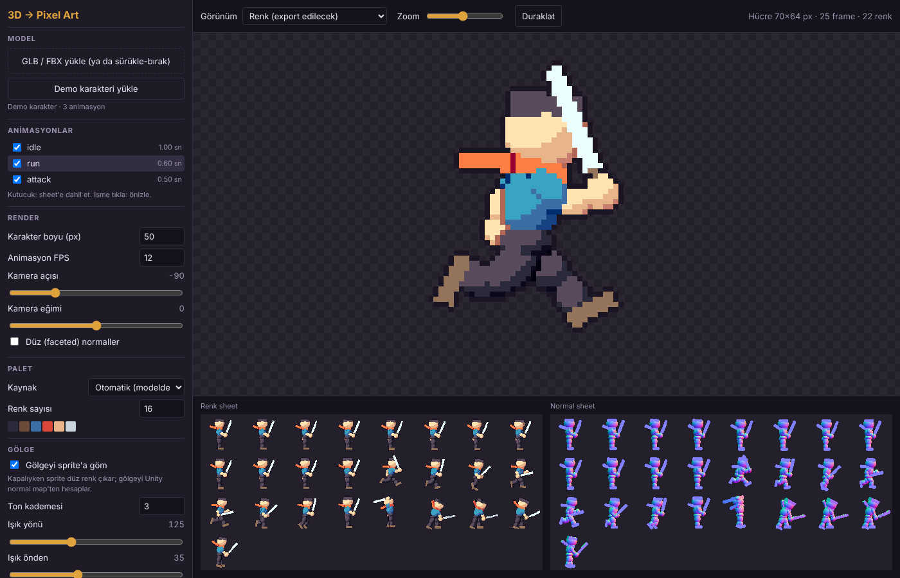

# 3D → Pixel Art Sprite Aracı

3D model ve animasyonlardan **pixel art sprite sheet + normal map** üreten tarayıcı aracı.
Dead Cells'in üretim yöntemini temel alır: karakteri piksel piksel çizmek yerine basit bir
3D modeli canlandırırsın, araç her pozu pixel art frame'e çevirir.



## Çalıştırma

```bash
npm install
npm run dev      # http://localhost:5173
npm test         # piksel işleme testleri
```

## Kullanım

1. Blender'da modelini **GLB** (ya da FBX) olarak export et, animasyonlar dahil. Pencereye sürükle-bırak.
2. Sol panelden ayarla; sonuç anında güncellenir.
3. **Sheet + Normal + JSON indir** → `isim_color.png`, `isim_normal.png`, `isim.json`.
4. Unity'de: `unity/Editor/PixelSheetImporter.cs` dosyasını projende `Assets/Editor/` altına kopyala.
   Üç dosyayı aynı klasöre at, `.json`'a sağ tıkla → **Pixel Sheet > Import**.
   Sprite'lar dilimlenir, normal map `_NormalMap` olarak bağlanır, animasyon klipleri oluşur.

## Neden "pixelated" değil de pixel art çıkıyor

| Adım | Ne yapıyor |
| --- | --- |
| Hedef çözünürlükte render | Büyük render alıp küçültmek yok. Mesh doğrudan ~50 px boyunda, antialiasing'siz çizilir. |
| Ortak, sınırlı palet | Palet bütün animasyonların bütün frame'lerinden bir kez çıkarılır (ya da Lospec paleti yapıştırırsın). Frame'ler arası renk titremez. |
| Kademeli gölge | Gölge, normal map'ten 2-4 kademe olarak hesaplanır; gölgeler mora, ışıklar sarıya kayar (hue shift). |
| Outline ve iç çizgiler | 1 px dış çizgi; derinlik farkından kol/gövde ayrımı için iç çizgi. |
| Temizlik | Yetim pikseller silinir, tek piksellik delikler kapanır. |
| Düşük FPS | Animasyon 12 fps'te örneklenir; ara değer üretilmez. |
| Sabit hücre ve pivot | Bütün frame'ler aynı hücre boyutunda, ayak noktası hep aynı pikselde. |

## Model hazırlarken

Sonucun kalitesini en çok model belirler:

- **Orijin ayakların altında**, karakter **+Y yukarı, öne doğru bakıyor** olsun (Blender'ın GLB export varsayılanı).
- **Düz renkli materyaller** kullan; detaylı doku 50 pikselde gürültüye döner.
- **Oranları abart**: büyük kafa, el, ayak, silah. İnce parçalar 1 pikselin altına düşüp titrer.
- Animasyonu **pose-to-pose** kur: güçlü anahtar pozlar, az ara poz.

## İki gölge modu

- **Gölgeyi sprite'a göm (açık):** Gölge sprite'ın içinde, Unity'de ek kurulum gerekmez.
- **Kapalı:** Sprite düz renk çıkar, gölgeyi Unity'nin 2D ışıkları normal map'ten hesaplar (Dead Cells'in yolu).
  "Işık simülasyonu" görünümü bunun nasıl duracağını gösterir.

## Kod yapısı

- `src/capture.js` — Three.js ile düz renk / normal / derinlik geçişleri, hücre ve pivot hesabı
- `src/pixel.js` — palete oturtma, gölge, outline, temizlik, sheet paketleme (saf fonksiyonlar)
- `src/palette.js`, `src/color.js` — OKLab uzayında palet çıkarma ve renk eşleme
- `src/main.js` — arayüz
- `unity/Editor/PixelSheetImporter.cs` — Unity içe aktarıcı

## Kaynak

Thomas Vasseur, [Art Design Deep Dive: Using a 3D pipeline for 2D animation in Dead Cells](https://www.gamedeveloper.com/production/art-design-deep-dive-using-a-3d-pipeline-for-2d-animation-in-i-dead-cells-i-)
